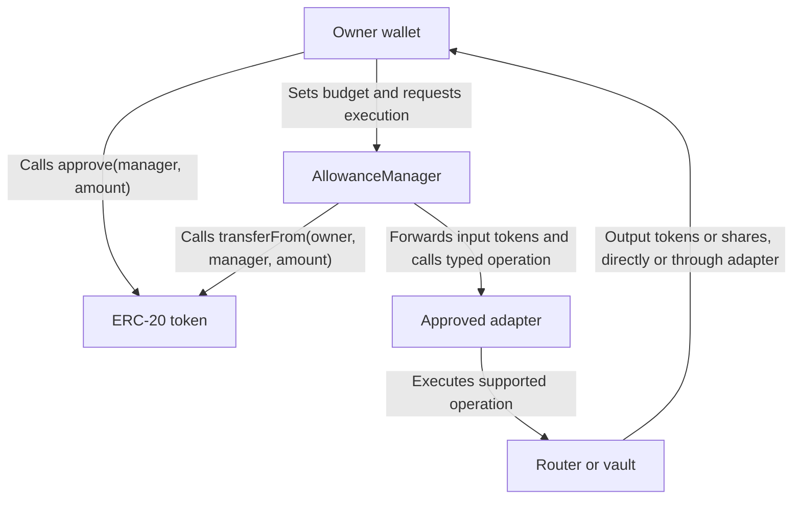

# AllowanceManager Design

## 1. Scope

AllowanceManager enforces per-owner, per-token budgets for operations
executed through the manager.

It does not control direct ERC-20 transfers or approvals made outside
the manager.

## 2. Roles

- Owner: the wallet that owns the input tokens.
- AllowanceManager: checks the owner's app budget and pulls input tokens.
- Adapter: integrates with a supported swap router or vault.
- Router/vault: the supported protocol that executes the operation.

For the MVP, owners submit their own transactions.
The manager derives the owner from msg.sender.
The AI/backend prepares transaction data; it cannot spend tokens by itself.

## 3. ERC-20 Approval

The owner calls approve(managerAddress, amount) on the token contract.

This creates an ERC-20 allowance:
- token owner: the user's wallet
- spender: AllowanceManager

Approval does not transfer tokens and does not create an app budget.

## 4. Proposed Execution Flow

1. Owner approves AllowanceManager on the input token.
2. Owner sets a budget and expiry in AllowanceManager.
3. Owner calls a typed executeSwap or executeDeposit operation.
4. Manager validates the token, adapter, budget and expiry.
5. Manager decreases the remaining budget by the input amount.
6. Manager calls transferFrom(owner, manager, amount).
7. Manager forwards that amount to the approved adapter.
8. Adapter executes the supported router/vault operation.
9. Output tokens or vault shares are delivered to the owner.

If any required step fails, the entire transaction must revert,
including the budget decrease and token movements.

The adapter integration must define any additional approval needed
between the adapter and its router/vault.

## 5. Approval and Token Flow

## 6. ERC-20 Allowance vs App Budget

- ERC-20 allowance is stored in the token contract.
- App budget is stored in AllowanceManager.
- Setting a budget does not call ERC-20 approve.
- Both allowance and budget must be sufficient for execution.
- The owner's token balance must also be sufficient.

Example:
- Owner balance: 100 USDC
- ERC-20 allowance to manager: 50 USDC
- App remaining budget: 20 USDC

A request to spend 25 USDC must fail because it exceeds the app budget.

After a successful operation spending 10 USDC,
the app remaining budget becomes 10 USDC.

## 7. Protection Boundary

- App revoke disables the owner's budget for the selected token.
- App revoke does not clear the ERC-20 allowance in the token contract.
- Clearing that allowance requires a separate token approve(manager, 0).
- An expired budget must block execution through the manager.
- Direct transfers and other spenders remain outside this protection.

## 8. Budget Storage and Semantics

- Budgets are stored by owner address and token address:
  budgets[owner][token].
- Each budget stores remaining and expiry.
- remaining uses the token's smallest unit.
- expiry is a Unix timestamp in seconds.
- A budget is expired when block.timestamp >= expiry.
- A budget that has never been set is inactive.
- Budgets do not automatically reset each day.
- setBudget replaces the previous remaining amount and expiry.
- A new budget must have an expiry strictly in the future.
- Budget-setting and revocation functions derive the owner from msg.sender.
- There is no shared global spending budget across all owners.

## 9. Budget Management Functions

- setBudget(token, amount, expiry) replaces the caller's budget.
- token must not be the zero address.
- amount must be greater than zero.
- expiry must be strictly greater than block.timestamp.
- revoke(token) clears the caller's budget and emits BudgetRevoked.
- Repeated revocation is allowed.
- remaining(owner, token) returns zero for expired or unset budgets.
- BudgetSet and BudgetRevoked identify the owner and token.
- Budget management does not change ERC-20 approvals.
- Token and adapter support checks are still required in execution.

## 10. Typed Execution Interfaces

### Manager entry points

The planned manager entry points are:

- executeSwap(tokenIn, tokenOut, amountIn, minAmountOut, deadline)
- executeDeposit(token, amount, minSharesOut, deadline)

These entry points are not implemented yet.

### Policy and ownership

- The manager derives the owner from msg.sender.
- The manager sets the adapter recipient to that owner.
- The caller cannot supply an arbitrary recipient.
- The manager resolves adapters from an approved configuration.
- Adapter approval must be bound to the supported token pair or vault.
- The prompt cannot introduce arbitrary tokens, adapters, routers or vaults.
- The MVP exposes no generic target.call(calldata) execution entry point.

### Adapter execution

- The manager checks budget, expiry and execution parameters first.
- The manager decreases budget before external token or adapter calls.
- The manager pulls and forwards the exact input amount.
- Adapters receive input tokens before executing their typed operation.
- Adapter implementations must accept execution only from the manager.
- Router/vault addresses and supported routes are configured by policy.
- Adapters must enforce minimum output and deadline.
- Output tokens or shares must be delivered to the owner.
- Any required failure must revert the entire transaction.
- The execution implementation must include reentrancy protection.

### Current implementation status

- ISwapAdapter and IVaultAdapter define function signatures only.
- Interfaces do not enforce authorization or execution checks.
- Manager execution and concrete adapters still require implementation.

## 11. Draft Status and Handoff

### Implemented

- Per-owner, per-token budget storage.
- setBudget with owner derived from msg.sender.
- Budget replacement without automatic daily reset.
- Expiry validation and effective remaining-budget queries.
- Owner-scoped revocation.
- BudgetSet and BudgetRevoked events.
- Typed ISwapAdapter and IVaultAdapter interfaces.

### Verified

15 AllowanceManager tests pass locally, covering:

- Unset budgets.
- Budget creation, replacement and events.
- Independent budgets across owners and tokens.
- Invalid token, amount and expiry inputs.
- Exact expiry boundary and replacement expiry.
- Revocation, repeated revocation and setting a new budget.
- Budget management leaves token balances and ERC-20 allowances unchanged.

### Pending Execution Integration

- executeSwap and executeDeposit are not implemented.
- Adapter interfaces do not implement actual protocol operations.
- Spending caps are not yet enforced on swap/deposit transactions.
- Execution must enforce budget, expiry, supported tokens/adapters,
  minimum output, deadline and owner-bound recipient.
- Execution must include reentrancy protection.
- Execution tests must cover spending exactly the remaining budget,
  exceeding it, expiry, revocation and transaction rollback.

### Dev 1 Handoff

- remaining(owner, token) reports the effective app budget.
- An expired, revoked or unset budget returns zero.
- setBudget and revoke require a transaction from the owner's wallet.
- App budget is separate from ERC-20 allowance.
- The AI/backend cannot spend tokens without an authorized execution flow.

### Dev 3 Handoff

- The ABI is a draft for budget management.
- Token amounts use raw integer units.
- Expiry uses Unix seconds.
- App revoke does not clear ERC-20 approval.
- Swap/deposit execution is not available in this draft.