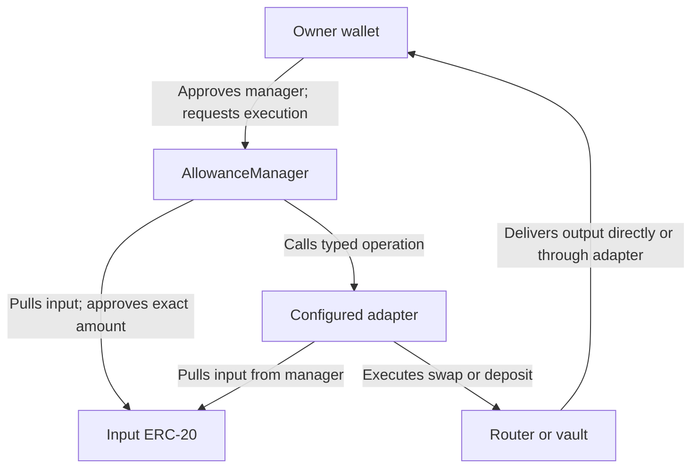

# AllowanceManager Design

## 1. Scope

AllowanceManager enforces per-owner, per-token budgets for operations
executed through the manager.

It does not control direct ERC-20 transfers or approvals made outside
the manager.

## 2. Roles

- Owner: the wallet that owns the input tokens.
- AllowanceManager: checks the owner's app budget and pulls input tokens.
- Adapter: integrates with a supported swap router or vault.
- Router/vault: the supported protocol that executes the operation.

For the MVP, owners submit their own transactions.
The manager derives the owner from msg.sender.
The AI/backend prepares transaction data; it cannot spend tokens by itself.

## 3. ERC-20 Approval

The owner calls approve(managerAddress, amount) on the token contract.

This creates an ERC-20 allowance:
- token owner: the user's wallet
- spender: AllowanceManager

Approval does not transfer tokens and does not create an app budget.

## 4. Proposed Execution Flow

1. Owner approves AllowanceManager on the input token.
2. Owner sets a budget and expiry.
3. Owner calls executeSwap or executeDeposit.
4. Manager derives owner and recipient from msg.sender.
5. Manager validates supported tokens, configured adapter, amount,
   deadline and minimum output.
6. Manager consumes the owner's input-token budget.
7. Manager pulls the exact input amount using SafeERC20.safeTransferFrom.
8. Manager approves only the configured adapter for that exact amount.
9. Adapter pulls input tokens from the manager and executes the operation.
10. Output tokens or vault shares are delivered to the owner.
11. Manager resets the adapter's input-token allowance to zero.
12. Manager verifies input custody and actual recipient output.

Execution must revert atomically if any required check or operation fails.
The manager must not retain input tokens from a successful operation.
Pre-existing manager balances must not be spent by the operation.

## 5. Approval and Token Flow

## 6. ERC-20 Allowance vs App Budget

- ERC-20 allowance is stored in the token contract.
- App budget is stored in AllowanceManager.
- Setting a budget does not call ERC-20 approve.
- Both allowance and budget must be sufficient for execution.
- The owner's token balance must also be sufficient.

Example:
- Owner balance: 100 USDC
- ERC-20 allowance to manager: 50 USDC
- App remaining budget: 20 USDC

A request to spend 25 USDC must fail because it exceeds the app budget.

After a successful operation spending 10 USDC,
the app remaining budget becomes 10 USDC.

## 7. Protection Boundary

- App revoke disables the owner's budget for the selected token.
- App revoke does not clear the ERC-20 allowance in the token contract.
- Clearing that allowance requires a separate token approve(manager, 0).
- An expired budget must block execution through the manager.
- Direct transfers and other spenders remain outside this protection.

## 8. Budget Storage and Semantics

- Budgets are stored by owner address and token address:
  budgets[owner][token].
- Each budget stores remaining and expiry.
- remaining uses the token's smallest unit.
- expiry is a Unix timestamp in seconds.
- A budget is expired when block.timestamp >= expiry.
- A budget that has never been set is inactive.
- Budgets do not automatically reset each day.
- setBudget replaces the previous remaining amount and expiry.
- A new budget must have an expiry strictly in the future.
- Budget-setting and revocation functions derive the owner from msg.sender.
- There is no shared global spending budget across all owners.

## 9. Budget Management Functions

- setBudget(token, amount, expiry) replaces the caller's budget.
- token must not be the zero address.
- amount must be greater than zero.
- expiry must be strictly greater than block.timestamp.
- revoke(token) clears the caller's budget and emits BudgetRevoked.
- Repeated revocation is allowed.
- remaining(owner, token) returns zero for expired or unset budgets.
- BudgetSet and BudgetRevoked identify the owner and token.
- Budget management does not change ERC-20 approvals.
- Execution checks supported tokens and configured adapters.

## 10. Typed Execution Interfaces

### Manager entry points

Implemented:

- executeSwap(tokenIn, tokenOut, amountIn, minAmountOut, deadline)
- executeDeposit(token, amount, minSharesOut, deadline)

Owner and recipient are derived from msg.sender.
Neither entry point accepts an arbitrary target, recipient or calldata.

### Policy configuration

- policyAdmin is the deployer and is immutable.
- Only policyAdmin can change token support and adapter configuration.
- Swap adapters are configured per directional token pair.
- Each input token has one configured vault adapter and share token.
- Input and output/share tokens must be supported.
- A zero adapter disables the route.
- Checking code.length confirms contract code exists, not that it is safe.
- Production adapters and their router/vault bindings require review.
- Fee-on-transfer, rebasing and other nonstandard token behavior are
  outside the supported-token policy.

### Execution and custody

- The manager validates policy, deadline and minimum output.
- _consumeBudget validates amount, budget expiry and remaining budget.
- Budget is decreased before external interactions.
- SafeERC20 pulls input from the owner.
- Balance checks require the owner to lose and manager to receive
  exactly the requested input amount.
- The manager approves only the configured adapter for that amount.
- The adapter pulls input from the manager.
- Recipient is fixed to the owner.
- After execution, adapter allowance is reset to zero and checked.
- Manager input balance must return to its pre-operation value.
- Owner input balance must reflect exactly the requested spend.
- Actual owner output/share balance increase must meet the minimum.
- Adapter-reported output must equal the observed balance increase.
- Execution is exact-input: partial consumption reverts.
- Execution and external configuration/budget mutations use
  ReentrancyGuard.
- Required failures revert budget updates, transfers and approvals.

### Time semantics

- Budget is expired when block.timestamp >= expiry.
- Execution deadline is expired when block.timestamp > deadline.
- Budget expiry and execution deadline are separate conditions.

### Events

- BudgetSet
- BudgetRevoked
- TokenSupportUpdated
- SwapAdapterUpdated
- VaultAdapterUpdated
- SwapExecuted
- DepositExecuted

## 11. Verification and Handoff

### Confirmed local verification

- 15 budget-management tests.
- 13 internal budget-consumption tests.
- 7 DemoToken tests.
- 57 execution/security tests passed in a separate security-file run.
- Complete contract suite passed together: 92 tests.

Execution/security coverage includes:

- Successful swap and deposit, including events and owner output.
- Exact budget cap and rejection one raw unit above it.
- Caller budget isolation.
- Disabled tokens and routes.
- Execution deadline and budget expiry.
- Revocation and insufficient ERC-20 approval.
- Minimum output validation.
- Direct adapter-call rejection.
- Non-admin policy-update rejection.
- Downstream revert with atomic rollback.
- Wrong recipient and incorrect reported output.
- Rejection of partial input consumption.
- Preservation of pre-existing manager input balance.
- False-return transferFrom rejection.
- Rejection and rollback of the tested fee-on-transfer input token.
- Reentrant callbacks into execution and budget-management functions.
- Exact adapter allowance and rejection of an excessive pull.

### Limits of evidence

- Execution tests use local mock adapters.
- Real router/vault integration has not been verified by these tests.
- Mock swaps and deposits use a 1:1 raw-unit conversion.
- The fee-token test covers the specific mock behavior, not all token
  variants. Rebasing tokens remain excluded by policy.
- This verification is not an independent security audit.
- Protection applies only to execution through this manager.
- The manager has not been deployed or verified on Fuji in this work.
- Mock contracts and the harness are for local testing only.

### ABI draft

- Path: contracts/abi/AllowanceManager.json
- Exported entry count: 38.
- Includes budget management, policy configuration and execution.
- ABI entry count alone does not prove ABI freshness or correctness.
- Export from the compiled artifact after contract changes.

### Dev 1 handoff

- Use typed execution arguments and approved policy configuration.
- Transactions require the owner's wallet authorization.
- Budget and ERC-20 allowance are separate requirements.
- An expired, revoked or unset budget returns zero from remaining.
- Handle contract reverts; do not promise success before execution.
- No arbitrary target/call-data execution is exposed.

### Dev 3 handoff

- Use the draft ABI for frontend integration.
- Amounts and minimum outputs use each token's raw integer units.
- Expiry and deadline use Unix seconds.
- Wallet calls establish owner through msg.sender.
- App revoke does not clear the owner's ERC-20 approval.
- Contract address and final ABI must be confirmed before live use.