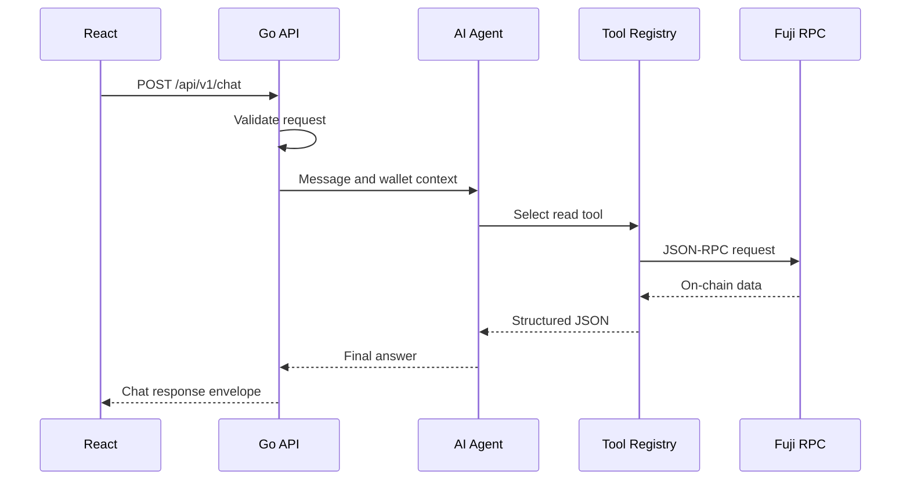
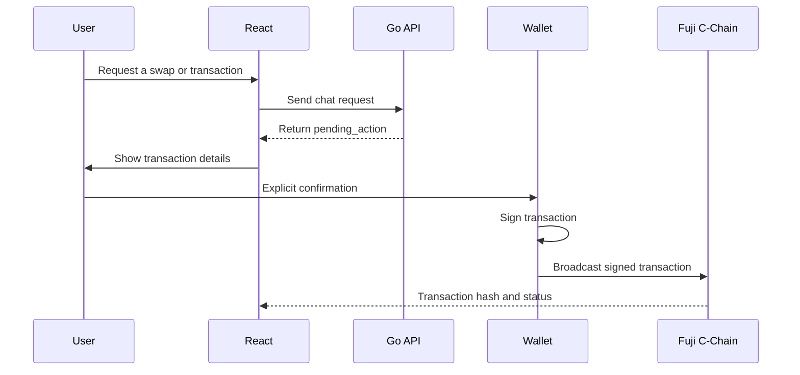

# DeFi Copilot Architecture

Last updated: 2026-10-27

## 1. MVP scope

DeFi Copilot is an AI assistant for Avalanche C-Chain.

The MVP currently targets:

- Network: Avalanche Fuji C-Chain
- Chain ID: `43113`
- Backend: Go and Fiber
- Blockchain client: `go-ethereum`
- Database: PostgreSQL
- Frontend: React
- Deployment: Docker

The MVP must support read-only blockchain operations before enabling
write operations.

## 2. Verified network configuration

| Item | Value | Status |
|---|---|---|
| Network | Avalanche Fuji C-Chain | Verified |
| Chain ID | `43113` | Verified through RPC |
| Native currency | AVAX | Verified |
| RPC URL | `https://api.avax-test.network/ext/bc/C/rpc` | Verified |
| Latest block | Read successfully | Implemented |
| Native AVAX balance | Read successfully | Implemented |
| Data API | Fuji native balance and paginated transaction history verified via Go spike | Client implemented; chat/tool integration pending |
| Lending protocol | Not selected | Pending team decision |
| Swap protocol | Not selected | Pending team decision |
| Demo ERC-20 contract | `0xcCCb83Fbe349fAebDE74Ce633D25B282E6FDd21A` | Deployed on Fuji; verified on Sourcify |
| Demo ERC-20 ABI | `contracts/abi/DemoToken.json` | Exported |
| Swap/vault contract addresses and ABI | Not available | Pending protocol feasibility checks |

No unverified protocol or contract will be presented as a production
mainnet integration.

## 3. Current backend flow



The current implementation has not connected the AI agent to the tool
registry yet. The Avalanche RPC client and API contract are prepared for
that integration.

## 4. Planned write flow



Safety requirements:

- The backend must not hold the user's private key.
- The AI must not broadcast a transaction automatically.
- Every write action must return a `pending_action`.
- The frontend must display transaction details before signing.
- The user's wallet must provide explicit confirmation.
- Contract and router addresses must be allowlisted.
- Chain ID must be checked before signing.

## 5. Chat API contract

### Endpoint

```http
POST /api/v1/chat
Content-Type: application/json
```

### Request

```json
{
  "session_id": "demo-session-001",
  "wallet_address": "0x0000000000000000000000000000000000000001",
  "chain_id": 43113,
  "locale": "en",
  "message": "Show my AVAX balance"
}
```

### Success response

```json
{
  "message": "Show my AVAX balance",
  "tool_calls": [],
  "pending_action": null,
  "sources": [],
  "request_id": "uuid",
  "error": null
}
```

### Error response

```json
{
  "message": "",
  "tool_calls": [],
  "pending_action": null,
  "sources": [],
  "request_id": "uuid",
  "error": {
    "code": "UNSUPPORTED_CHAIN_ID",
    "message": "chain_id must be 43113 for Avalanche Fuji"
  }
}
```

### Current validation rules

- `session_id` is required.
- `wallet_address` must be a valid EVM address.
- `chain_id` is required and must equal `43113`.
- `message` is required.
- `message` must not exceed 2,000 Unicode characters.
- `locale` must be `vi` or `en`.
- Invalid JSON returns HTTP 400.
- Timed-out requests return a structured HTTP 408 error.

## 6. RPC operations implemented

The Go backend currently supports:

### Verify network

```text
eth_chainId
```

Expected result:

```text
43113
```

### Read latest block

```text
eth_blockNumber
```

Implemented by:

```go
GetLatestBlockNumber(ctx, client)
```

### Read native AVAX balance

```text
eth_getBalance
```

Implemented by:

```go
GetNativeBalance(ctx, client, walletAddress)
```

Balance is returned in Wei and converted to AVAX without using
`float64`.

```text
1 AVAX = 1,000,000,000,000,000,000 Wei
```

## 7. RPC versus indexed Data API

Use RPC for:

- Chain ID
- Latest block
- Current native balance
- Current contract state
- Gas estimation
- Transaction receipt

Use an indexed Data API for:

- Transaction history
- Token transfer history
- Portfolio token discovery
- Token metadata
- Historical activity

The RPC spike supports chain verification, latest block, and native balance.
A separate Go Data API spike now reads Fuji native balance and paginated
transaction history. Integration with the AI agent and tool registry remains
pending.

### Dev 2 integration decision — 2026-10-27

- Fuji native balance and transaction history endpoints were tested
  successfully without an API key. Two transaction pages were retrieved
  using nextPageToken. Token discovery and metadata endpoints remain untested.
- Use RPC contract calls for ERC-20 balances, allowance, and contract state.
- Evaluate the indexed Data API for Fuji transaction history, token
  discovery, and metadata. Fuji support, authentication, and pagination
  are not verified yet.
- Check swap, lending, and vault integrations separately before selecting
  a protocol or fallback.
- The deployed DemoToken is a test asset, not a swap, lending, or vault
  integration.

DemoToken handoff:

- Network: Avalanche Fuji C-Chain
- Chain ID: 43113
- Address: 0xcCCb83Fbe349fAebDE74Ce633D25B282E6FDd21A
- Symbol: DDEMO
- Decimals: 18
- ABI: contracts/abi/DemoToken.json
- Deployment record: contracts/deployments/fuji.json
- Source verification: https://sourcify.dev/server/repo-ui/43113/0xcCCb83Fbe349fAebDE74Ce633D25B282E6FDd21A

### Data API verification evidence — 2026-10-27

- Base URL: https://data-api.avax.network
- Chain ID: 43113
- Wallet: 0x4DFb0d91C07A7C706F65F974953cE8b111D27Ee5
- Native balance and transaction history requests returned HTTP 200
  without an API key in this test.
- Pagination: pageSize=1, sortOrder=desc; two pages retrieved.
- Page 1: DemoToken deployment at block 60107076.
- Page 2: receipt of 100000000000000000 Wei at block 60106826.
- No nextPageToken was returned after page 2.
- Five offline Data API tests passed.
- Fixtures: backend/internal/avalanche/testdata/
- Reproduce from backend/:
  go run ./cmd/data-api-spike 0x4DFb0d91C07A7C706F65F974953cE8b111D27Ee5

The client accepts an optional AVALANCHE_DATA_API_KEY environment variable.
These results do not establish anonymous access or quota guarantees for
all Data API endpoints.

Observed-at timestamps describe response observation time, not the block
at which the native balance was read. The balance response used here does
not include a block number.

### LFJ Fuji swap feasibility

Verified through read-only Fuji RPC calls:

- Chain ID: `43113`
- Version: Liquidity Book V2.2
- Factory: `0xb43120c4745967fa9b93E79C149E66B0f2D6Fe0c`
- Router: `0x18556DA13313f3532c54711497A8FedAC273220E`
- Quoter: `0x9A550a522BBaDFB69019b0432800Ed17855A51C3`
- All three addresses returned non-empty bytecode.
- Factory returned one USDT/USDC pool:
  `0xc3b7307184381f65B398d385a71EF0490239a2b3`
- Pool bin step: `1`; ignored for routing: `false`.
- Both tokens use 6 decimals.

Pool reserves at block `60110788`:

- USDT: `3138039978` raw (`3138.039978` USDT).
- USDC: `1960697332` raw (`1960.697332` USDC).

Router quotes at block `60110817`:

- 1 USDT -> 0.9999 USDC.
- 1 USDC -> 0.9999 USDT.
- Both returned amountInLeft = 0.
- Each returned a fee of 100 raw input-token units.

Decision: LFJ V2.2 is a viable candidate for the tested Fuji
USDT/USDC quote path. Liquidity and quotes must be checked again
at request time.

LBQuoter verified at block `60110974`:

- Tested token paths: USDT -> USDC and USDC -> USDT.
- Both selected pool `0xc3b7307184381f65B398d385a71EF0490239a2b3`.
- Selected version: V2.2; bin step: 1.
- Both returned 999900 raw output for 1000000 raw input.
- Pool selection works for the supplied direct token paths.
  Automatic discovery of intermediate token paths is not implemented.

Pending: wallet swap execution and lending/vault feasibility.
No swap transaction has been submitted.

### Aave V3 Fuji feasibility and Risk Gate A

Network: Avalanche Fuji C-Chain, chain ID `43113`.

Verified addresses:

- Addresses Provider: `0x07D04EfAAA0Ac69D19d107795aF247C42Eb50F1C`
- Pool: `0x8B9b2AF4afB389b4a70A474dfD4AdCD4a302bb40`
- Protocol Data Provider: `0xC65cbd1e309Bf0e841Ee6f6E786480598e6a4014`
- USDC: `0x5425890298aed601595a70AB815c96711a31Bc65`
- USDC aToken: `0x9CFcc1B289E59FBe1E769f020C77315DF8473760`

At block `60111338`, the USDC reserve was active, not frozen,
not paused, with collateral and borrowing enabled.
USDC decimals: 6. Supply cap was 0 (unlimited) at block `60111510`.

Executed with the Dev 2 test deployer wallet:

- Approval: 0.1 USDC to the Pool.
  Transaction: `0x62aef2ae610b07b325b8dde37d70c5299bff6be24dffebadb3566c9e5bdd07af`
- Supply: 0.1 USDC; confirmed block `60111857`.
  Transaction: `0x8fc60d9892b76ba211c48d8fd01d5e17db5195569fb19c6d570f83943d6d3d4b`
  Wallet USDC: 20 -> 19.9; aToken: 0 -> 0.1.
- Withdraw: 0.1 USDC; confirmed block `60111917`.
  Transaction: `0x3b61008d6400772ce94848239c431d7dae62fa78360af24a8b334d6ae81b4e72`
  Wallet USDC: 19.9 -> 20; aToken: 0.1 -> 0.

Risk Gate A decision:

- Use Aave V3 Fuji as the lending integration candidate.
- Supply and withdraw are verified for the tested USDC amount.
- A fallback caused by unavailable lending is not currently required.
- Borrowing, liquidation, oracle validation and a separate vault
  integration remain unverified.
- Aave USDC and the tested LFJ USDC have different addresses;
  they must not be treated as the same asset.
- These scripts are developer feasibility tools. Product transactions
  must use explicit user wallet confirmation and signing.

## 8. Pending team decisions

The team still needs to decide:

1. Which LLM provider will be used for the MVP.
2. Which lending or vault integration is reliable on Fuji.
3. Which quote and swap provider will be used.
4. Which additional swap/vault contracts Dev 2 will deploy.
5. Final swap/vault addresses and ABI; DemoToken address and ABI are available.
6. Exact fields inside `pending_action`.
7. Whether an indexed Data API key is required.

Until those decisions are finalized, backend development will use
interfaces and mock implementations for unavailable services.

## 9. Environment variables

```env
AVALANCHE_RPC_URL=https://api.avax-test.network/ext/bc/C/rpc
AI_API_KEY=
```

Secrets must only exist in a local `.env` file or deployment secret
manager. They must never be committed to Git.

The backend must not require a user's wallet private key for read
operations.