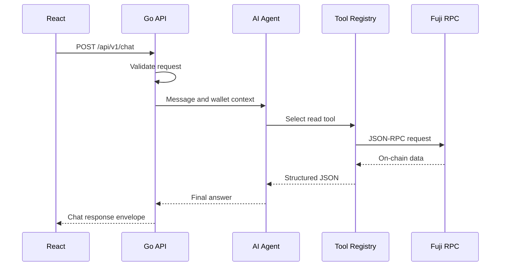
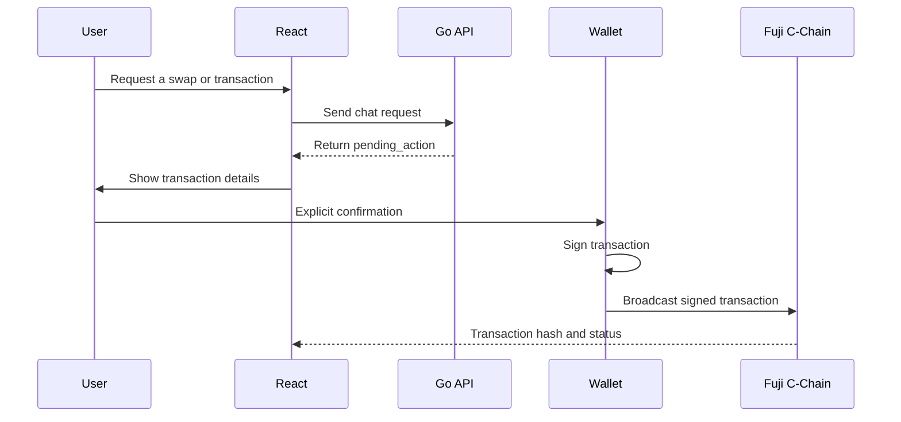

# DeFi Copilot Architecture

Last updated: 2026-10-26

## 1. MVP scope

DeFi Copilot is an AI assistant for Avalanche C-Chain.

The MVP currently targets:

- Network: Avalanche Fuji C-Chain
- Chain ID: `43113`
- Backend: Go and Fiber
- Blockchain client: `go-ethereum`
- Database: PostgreSQL
- Frontend: React
- Deployment: Docker

The MVP must support read-only blockchain operations before enabling
write operations.

## 2. Verified network configuration

| Item | Value | Status |
|---|---|---|
| Network | Avalanche Fuji C-Chain | Verified |
| Chain ID | `43113` | Verified through RPC |
| Native currency | AVAX | Verified |
| RPC URL | `https://api.avax-test.network/ext/bc/C/rpc` | Verified |
| Latest block | Read successfully | Implemented |
| Native AVAX balance | Read successfully | Implemented |
| Data API | Not integrated | Pending |
| Lending protocol | Not selected | Pending team decision |
| Swap protocol | Not selected | Pending team decision |
| Contract addresses | Not available | Pending Dev 2 |
| Contract ABI | Not available | Pending Dev 2 |

No unverified protocol or contract will be presented as a production
mainnet integration.

## 3. Current backend flow



The current implementation has not connected the AI agent to the tool
registry yet. The Avalanche RPC client and API contract are prepared for
that integration.

## 4. Planned write flow



Safety requirements:

- The backend must not hold the user's private key.
- The AI must not broadcast a transaction automatically.
- Every write action must return a `pending_action`.
- The frontend must display transaction details before signing.
- The user's wallet must provide explicit confirmation.
- Contract and router addresses must be allowlisted.
- Chain ID must be checked before signing.

## 5. Chat API contract

### Endpoint

```http
POST /api/v1/chat
Content-Type: application/json
```

### Request

```json
{
  "session_id": "demo-session-001",
  "wallet_address": "0x0000000000000000000000000000000000000001",
  "chain_id": 43113,
  "locale": "en",
  "message": "Show my AVAX balance"
}
```

### Success response

```json
{
  "message": "Show my AVAX balance",
  "tool_calls": [],
  "pending_action": null,
  "sources": [],
  "request_id": "uuid",
  "error": null
}
```

### Error response

```json
{
  "message": "",
  "tool_calls": [],
  "pending_action": null,
  "sources": [],
  "request_id": "uuid",
  "error": {
    "code": "UNSUPPORTED_CHAIN_ID",
    "message": "chain_id must be 43113 for Avalanche Fuji"
  }
}
```

### Current validation rules

- `session_id` is required.
- `wallet_address` must be a valid EVM address.
- `chain_id` is required and must equal `43113`.
- `message` is required.
- `message` must not exceed 2,000 Unicode characters.
- `locale` must be `vi` or `en`.
- Invalid JSON returns HTTP 400.
- Timed-out requests return a structured HTTP 408 error.

## 6. RPC operations implemented

The Go backend currently supports:

### Verify network

```text
eth_chainId
```

Expected result:

```text
43113
```

### Read latest block

```text
eth_blockNumber
```

Implemented by:

```go
GetLatestBlockNumber(ctx, client)
```

### Read native AVAX balance

```text
eth_getBalance
```

Implemented by:

```go
GetNativeBalance(ctx, client, walletAddress)
```

Balance is returned in Wei and converted to AVAX without using
`float64`.

```text
1 AVAX = 1,000,000,000,000,000,000 Wei
```

## 7. RPC versus indexed Data API

Use RPC for:

- Chain ID
- Latest block
- Current native balance
- Current contract state
- Gas estimation
- Transaction receipt

Use an indexed Data API for:

- Transaction history
- Token transfer history
- Portfolio token discovery
- Token metadata
- Historical activity

The current spike uses RPC only. Data API integration remains pending.

## 8. Pending team decisions

The team still needs to decide:

1. Which LLM provider will be used for the MVP.
2. Which lending or vault integration is reliable on Fuji.
3. Which quote and swap provider will be used.
4. Which contracts Dev 2 will deploy.
5. Final contract addresses and ABI.
6. Exact fields inside `pending_action`.
7. Whether an indexed Data API key is required.

Until those decisions are finalized, backend development will use
interfaces and mock implementations for unavailable services.

## 9. Environment variables

```env
AVALANCHE_RPC_URL=https://api.avax-test.network/ext/bc/C/rpc
AI_API_KEY=
```

Secrets must only exist in a local `.env` file or deployment secret
manager. They must never be committed to Git.

The backend must not require a user's wallet private key for read
operations.